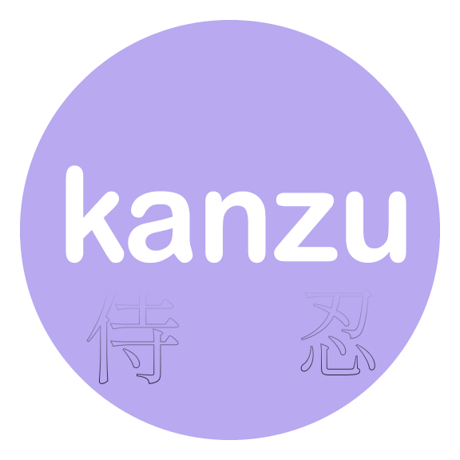

  

# Kanzu

**Kanzu** is an open source, free calligraphy and rhythm game, heavily inspired by [osu!](https://osu.ppy.sh/)

My mission with Kanzu is to:

- raise money for charity and for Osu! development;
- amplificate my game dev skills;
- bring fun for free to everybody!

## What is Kanzu?

Kanzu, as aforementioned, is an open-source and free game, where you have to draw kanjis (japanese letters) in sync!

## Where can I download it?

Kanzu is only available for Windows 10 or 11, altough currently there's no public release.

## Money

If you want to support Kanzu development, in the future, you'll be able to buy a Kanzu Supporter tag, for the time you want, starting for just 5$!

20% of the money this project raises by the end of a month will go to Osu! developers.
30% of the money this project raises by the end of a month will go to charity.

I only get 50% of the money.

## AI Usage
Yes, AI was used on the development of Kanzu. AI is a great tool for developers, and most of the code is still human code. AI was used only for tests and fixing bugs.

## License

Kanzu is distributed using GPL-V3 license. Check [LICENSE](https://github.com/SauloHS/kanzu/blob/main/LICENSE) for further details.
